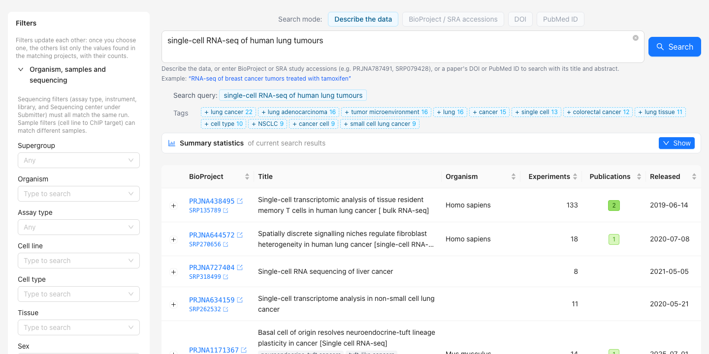
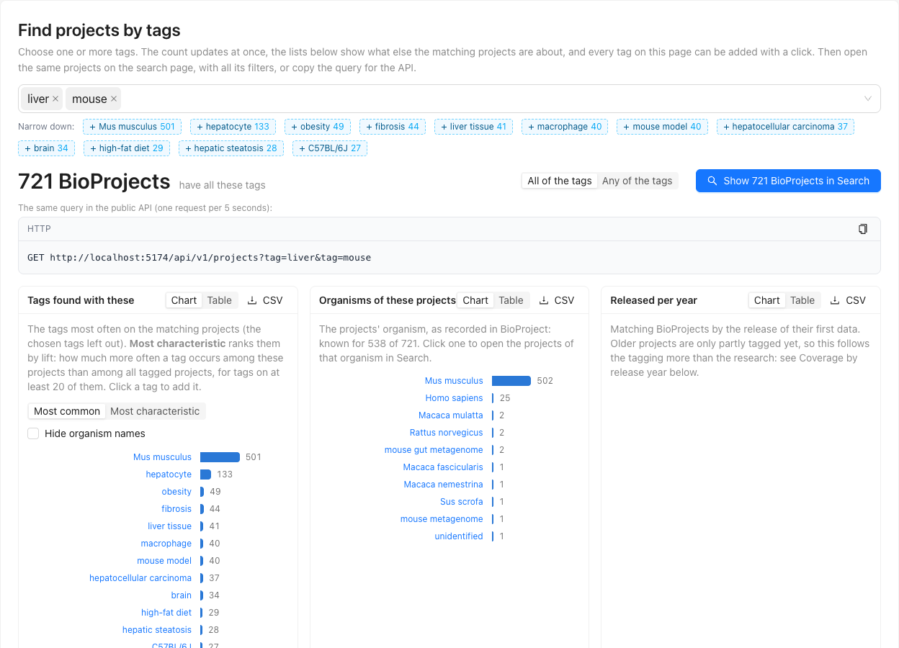
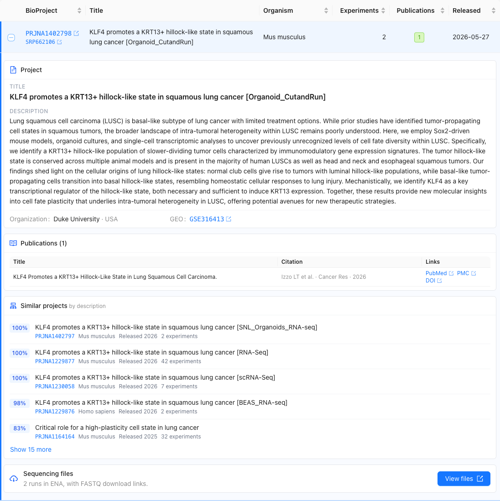
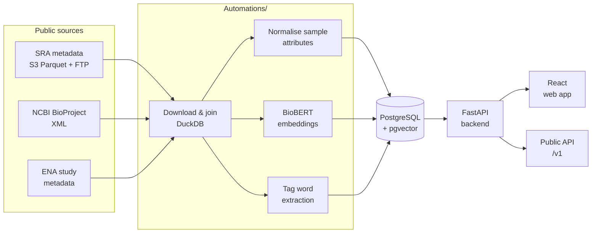

<div align="center">

# 🔭 SRAscout

### Find the sequencing data you need, by describing it.

**SRAscout** is a search engine for the NCBI [Sequence Read Archive (SRA)](https://www.ncbi.nlm.nih.gov/sra).<br>
Describe the data in plain language, paste a paper's DOI, or pick tags and filters, and go straight from a project to its FASTQ files.

[](https://www.srascout.com)
[](docs/api.md)
[](docs/)
[](LICENSE)


<br>



</div>

---

## ✨ Why SRAscout?

The SRA holds tens of millions of sequencing runs, but finding the right ones usually means guessing the exact keywords a submitter used. SRAscout brings **SRA run metadata, NCBI BioProject records and ENA study metadata into one database** and makes them searchable the way researchers actually think about their data.

| | |
| --- | --- |
| 🧠 **Describe the data** | Write *"single-cell RNA-seq of human lung tumours"* and get projects that mean the same thing, even when they say *"mice"* instead of *"mouse"*. A hybrid search fuses **BioBERT semantic similarity** with **full-text search**, so exact gene names and strain IDs are still found. |
| 🏷️ **Tag words** | BioProjects are tagged (about a quarter so far, growing with each update) with the organisms, diseases, tissues, cell types, cell lines, chemicals and environments its description mentions. **Deep search** reads the tags in your query and uses them to sharpen the results. |
| 📄 **Start from a paper** | Paste a **DOI** or **PubMed ID** to find the sequencing datasets behind a paper, or related to it. |
| 🎛️ **Filters that talk to each other** | Organism, tissue, cell type, sex, disease, assay, instrument, library layout, dates and more. Each filter only lists values that still match, with their counts. |
| 🔗 **Similar projects & files** | Open any project to see its publications, semantically similar studies, and links to ENA, NCBI and **FASTQ downloads**. |
| 📊 **Statistics & tag explorer** | Interactive charts of what is in the archive, a tag network, and tag co-occurrence, each with **CSV / JSON downloads**. |
| 🤖 **Public REST API** | Everything the site shows is also available from `/v1`: read-only, JSON, no key needed. |

---

## 📸 A quick tour

<table>
<tr>
<td width="50%" valign="top">

**Explore by tags**<br>
<sub>Pick tags, see how many projects have them, what else they are about, and copy the same query for the API.</sub>
<br><br>


</td>
<td width="50%" valign="top">

**Project details**<br>
<sub>Description, publications, similar projects by meaning, and a direct link to the sequencing files.</sub>
<br><br>


</td>
</tr>
</table>

---

## ⚙️ How it works



A text search runs two searches in parallel and merges them:

```
search text ──┬─► BioBERT embedding ──► nearest projects (HNSW index) ──┐
              │                                                         ├─► fuse (RRF) ─► filters ─► results
              └─► full-text query ────► projects with all words (GIN) ──┘
```

A **weekly update pipeline** (`Automations/Auto_update/`) adds new runs and projects every Sunday, so the database stays current. Details: [docs/search.md](docs/search.md), [docs/auto-update.md](docs/auto-update.md).

---

## 🤖 Public API

Query SRAscout from your own scripts. No key, JSON out, one request every 5 seconds per IP.

```bash
# Nanopore sequencing projects of bacteria
curl "https://www.srascout.com/v1/projects?supergroup=Bacteria&platform=OXFORD_NANOPORE&limit=5"

# Projects tagged both "liver" and "mouse"
curl "https://www.srascout.com/v1/projects?tag=liver&tag=mouse"

# Look up one project
curl "https://www.srascout.com/v1/projects/PRJNA438495"
```

| Endpoint | Purpose |
| --- | --- |
| `GET /v1/projects` | Search projects with filters |
| `GET /v1/projects/{accession}` | Look up a BioProject or SRA study |
| `GET /v1/filters` · `/v1/filters/{name}` | Every search parameter, and a filter's values with counts |
| `GET /v1/tags/related` · `/v1/tags/overview` | Tag statistics and co-occurrence |

Full reference: [docs/api.md](docs/api.md). Interactive docs are at `/docs` on any running server.

---

## 🚀 Run it locally

Requires Docker, Python 3.9+ and Node.js 20+.

```bash
# Database
docker run --name sra_explorer_dev -e POSTGRES_USER=postgres -e POSTGRES_PASSWORD=postgres \
  -e POSTGRES_DB=mydb -p 5432:5432 -d postgres:latest

# Backend (http://localhost:8000)
cd backend
python3 -m venv .venv
.venv/bin/pip install -r requirements.txt
.venv/bin/uvicorn app.main:app --reload

# Frontend (http://localhost:5173), in a second terminal
cd frontend
npm install
npm run dev
```

The scripts in [`Automations/metadata_dl/`](Automations/metadata_dl/) build the database from the public sources and are numbered in the order they run. See [docs/running.md](docs/running.md) for the full setup and configuration.

### Project structure

```
sra_explorer/
├── Automations/   Download SRA / BioProject / ENA metadata, build tables, embeddings and tags
├── backend/       FastAPI + SQLAlchemy API (website endpoints and public /v1 API)
├── frontend/      React + TypeScript + Vite app, Ant Design and Tailwind CSS
└── docs/          Documentation
```

| Layer | Technologies |
| --- | --- |
| Frontend | React, TypeScript, Vite, Ant Design, Tailwind CSS |
| Backend | Python, FastAPI, SQLAlchemy, Pydantic, sentence-transformers |
| Database | PostgreSQL, pgvector |
| Data | Bash and Python, DuckDB, Apache Parquet, BioBERT |

---

## 📚 Documentation

| Topic | |
| --- | --- |
| Running & configuration | [docs/running.md](docs/running.md) |
| How text search works | [docs/search.md](docs/search.md) |
| Search filters | [docs/filters.md](docs/filters.md) |
| BioProject tag words & tag explorer | [docs/bioproject-tags.md](docs/bioproject-tags.md) |
| Public API | [docs/api.md](docs/api.md) |
| Sample attribute normalisation | [docs/jattr-normalization.md](docs/jattr-normalization.md), [docs/normalization.md](docs/normalization.md) |
| Weekly auto-update | [docs/auto-update.md](docs/auto-update.md) |
| Production database & deployment | [docs/production.md](docs/production.md), [docs/deployment.md](docs/deployment.md) |
| Usage statistics (admin) | [docs/usage.md](docs/usage.md) |

---

## 🗂️ Data sources

SRAscout is built entirely from public data. All credit for the data goes to its submitters and to:

- **NCBI Sequence Read Archive**: run metadata from the public SRA metadata S3 bucket (Parquet) and FTP server
- **NCBI BioProject**: project records from `bioproject.xml`
- **European Nucleotide Archive (ENA)**: study metadata and FASTQ file links
- **NCBI PubMed**: publication details

## 📝 Citation

A paper describing SRAscout is in preparation. Until it is out, please cite this repository and link to [www.srascout.com](https://www.srascout.com).

## ⚖️ License

SRAscout is open source under the [MIT License](LICENSE). The data it serves comes from NCBI and ENA and is subject to their own terms.

<div align="center">
<br>
<sub>Made for researchers who would rather analyse data than hunt for it. Issues and pull requests are welcome.</sub>
</div>
